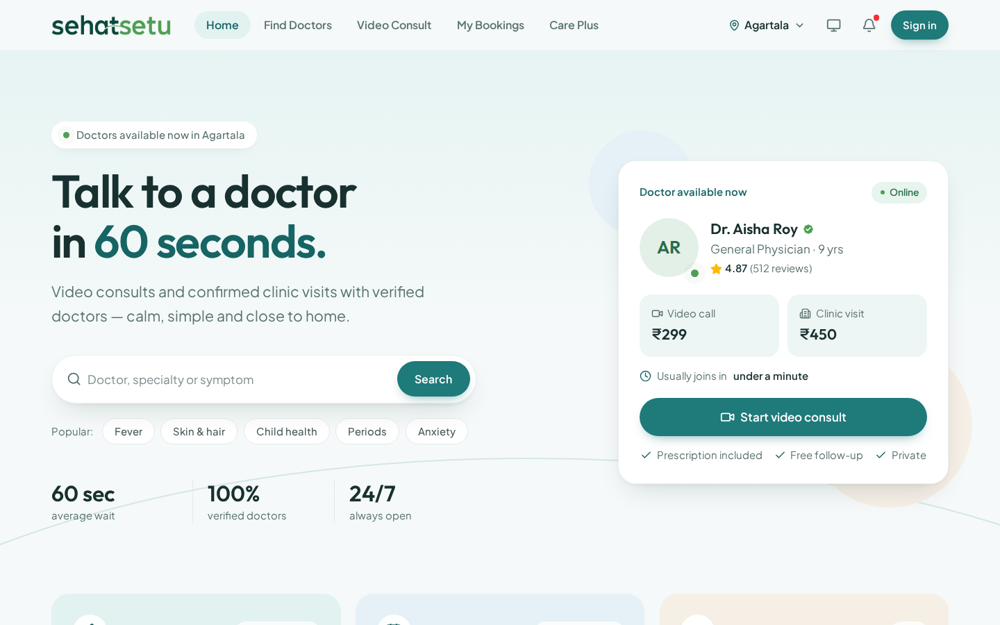
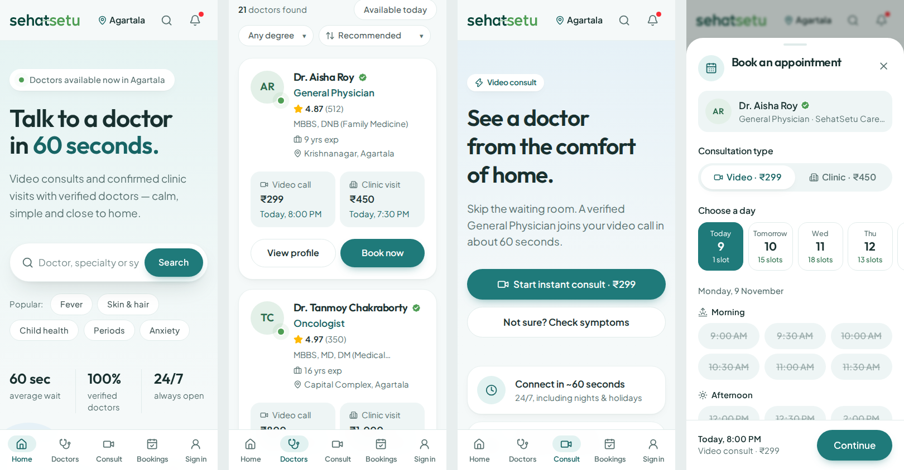

# SehatSetu — redesign

Modern, mobile-first redesign of https://uttamdasud.github.io/SehatSetu_Site/ built with React 19, Vite and Tailwind CSS v4.





## Deploy

Live site: https://arun2685.github.io/SehatSetu/

To publish changes, run:

```bash
npm run deploy
```

This builds the site and pushes `dist/` to the `gh-pages` branch, which GitHub Pages serves.

## Run locally

```bash
npm install
npm run dev        # http://localhost:5173
```

Production build (static files in `dist/`, works on GitHub Pages because of hash routing + relative paths):

```bash
npm run build
npm run preview
```

## What's inside

| Route | Page |
| --- | --- |
| `#/` | Home: search with suggestions, services, concerns, specialties, top doctors, symptom navigator, Care Plus, stories, articles, FAQ |
| `#/doctors` | Find doctors: search, video/clinic toggle, specialty chips, degree, "available today", sort (all synced to the URL) |
| `#/doctors/:id` | Doctor profile with booking widget |
| `#/consult` | Instant video consult + online specialists |
| `#/bookings` | Upcoming / completed / cancelled, reschedule, cancel, prescription |
| `#/plus` | Care Plus membership plans |

Dialogs: booking (slot picker → patient details → confirmation), instant consult, OTP sign-in, symptom navigator (flags emergencies → 108/112, crisis → Tele-MANAS 14416), prescription, cancel, account.

- Calm "Ocean" theme: cool white background, soft teal `#1F7A7A` (sits next to the logo greens), sand / sky / blush section tints, soft shadows, 17px base text. Opens in light mode by default; dark and auto (follow the device) are available from the theme button. All colours are tokens at the top of `src/index.css`.
- Layout is auto-fit, not fixed columns: `flex-fill` (items grow to share each row and wrap; the last row stretches) and `grid-fill` (equal auto columns, used for time slots), defined in `src/index.css`. Set the minimum item width per container, e.g. `className="flex-fill gap-4 [--min:18rem]"`.
- Other palettes ready to preview: add `?palette=sage`, `mist`, `earth` or `lavender` to the URL (e.g. `http://localhost:5173/?palette=mist`). `?palette=ocean` returns to the default.
- Logo: `public/logo.png` (transparent) and `public/logo-light.png` (for dark backgrounds); the original file is kept as `public/logo-original.webp`.
- Demo data lives in `src/data/`. State (sign-in, bookings, theme, city) is saved in `localStorage`; "Reset demo" is in the mobile Account sheet.
- Sign-in, payments, video calls and articles are demo stubs — no backend.

## Project layout

```
src/
  App.jsx               routes + layout
  index.css             Tailwind theme, design tokens, component classes
  lib/store.jsx         app state (user, bookings, dialogs, toasts, theme)
  lib/time.js           slot generation + date formatting
  lib/triage.js         keyword symptom navigator
  data/                 doctors + site content
  components/           header/footer/nav, dialogs, cards, UI primitives
  pages/                Home, Doctors, DoctorProfile, Consult, Bookings, Plus
```
